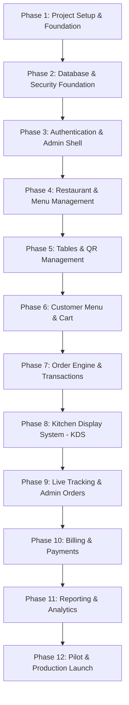

# TableTap — Multi-Phase Implementation Plan

This roadmap aligns directly with the 12 delivery phases outlined in `docs/07_DEVELOPMENT_PHASES.md` and the architecture in `docs/03_SYSTEM_ARCHITECTURE.md`.

---

## Phase Overview

---

## Detailed Milestone Breakdown

### Phase 1: Project Initialization & Foundation (CURRENT)
- [x] Workspace inspection and requirements alignment (`docs/`).
- [x] Next.js App Router, TypeScript, Tailwind CSS configuration.
- [x] shadcn/ui primitives (`Button`, `Card`, `Badge`, `Tabs`, `Input`, `Separator`).
- [x] Editorial design tokens (Warm cream, Forest green, Tomato red, Spice orange).
- [x] TypeScript domain type definitions (`Database`, `Roles`, `Orders`, `Menu`, `Cart`).
- [x] Supabase client architecture (`client.ts`, `server.ts`, `middleware.ts`, `admin.ts`).
- [x] PostgreSQL migration with Row Level Security (RLS) policies.
- [x] Zod input validation schemas.
- [x] TableTap brand landing page showcasing Customer, Kitchen, and Admin capabilities.
- [x] Project documentation pack.

### Phase 2: Database & Security Foundation
- Supabase project connection via `.env.local`.
- Run migration `20261105000001_initial_schema.sql`.
- Multi-tenant seed dataset:
  - Tenant A: "The Rustic Truffle" (Wood-fired pizza & small plates).
  - Tenant B: "Saffron & Spice" (Modern Indian bistro).
- Cross-tenant RLS unit & integration tests verifying absolute data isolation.

### Phase 3: Authentication & Role-Based Shells
- Supabase Auth integration (Email/Password & Magic Link).
- Minimal role enforcement: `owner`, `admin`, `kitchen`.
- Protected route layout groups:
  - `(admin)/dashboard`
  - `(kitchen)/kitchen`
  - `(public)/r/[restaurantSlug]`
- Unauthorized route redirects and audit session logging.

### Phase 4: Restaurant & Menu Management CMS
- Restaurant profile editor (branding, logo, currency, tax rates).
- Preparation stations management (Pizza, Grill, Bar, Desserts).
- Category CRUD with reordering and activation toggles.
- Product catalog management (names, photos, dietary markers, stations).
- Customization options engine (option groups, values, min/max selection).

### Phase 5: Tables & QR Token Engine
- Table management (table numbers, seating capacity, active status).
- Cryptographic unguessable QR token generation and revocation.
- Printable high-resolution QR sheet export (PNG/SVG/PDF).
- Stale session rotation and token invalidation.

### Phase 6: Customer Mobile Menu & Cart
- Mobile-first responsive digital menu (`(public)/r/[slug]/menu`).
- Table QR session resolution and banner (`Table 04`).
- Fast category filtering, search, and dietary toggle (Veg/Non-Veg).
- Product customization drawer (crust, toppings, instructions).
- Persistent browser session cart with instant recalculation.

### Phase 7: Order Engine & Transactional Pipeline
- Server-side order placement action (`createOrder`).
- Idempotency key deduplication to prevent double orders.
- Database-level price revalidation against canonical menu prices.
- Immutable purchase snapshot generation (`order_items`, `order_item_options`).
- Generation of human-friendly order numbers (e.g. `TT-1042`) and public tracking tokens.

### Phase 8: Kitchen Display System (KDS)
- High-contrast, tablet-optimized operational display (`(kitchen)/kitchen`).
- Supabase Realtime WebSocket subscription for incoming orders.
- Automatic station filtering (Pizza station sees pizza, Bar sees drinks, or All-station view).
- Status lifecycle transitions: `pending -> accepted -> preparing -> ready -> served`.
- Elapsed prep timers with amber/red delayed order thresholds.
- Audio alerts with mute/unmute control and reconnect polling fallback.

### Phase 9: Live Order Tracking & Admin Order Management
- Customer live tracking view (`/order/[publicOrderToken]`).
- Visual progress bar updating via Supabase Realtime events.
- Customer "Request Bill" signal to counter.
- Admin order log with filters (by table, status, date range, station).

### Phase 10: Billing & Payments
- Bill calculation engine (subtotal, tax, service charge, round-off).
- Pay-at-counter cash settlement workflow.
- Razorpay payment gateway integration (Indian online payments).
- Webhook signature verification and payment reconciliation.

### Phase 11: Analytics, Reports & UX Polish
- Admin sales dashboard with Recharts.
- Key metrics: Gross Revenue, Average Order Value (AOV), Peak Ordering Hours, Top Selling Dishes.
- CSV/PDF business report export.
- Lighthouse performance optimization (<100ms LCP, responsive audit).

### Phase 12: Production Pilot & Launch
- Production deployment on Vercel.
- Custom domain configuration and SSL verification.
- Live pilot deployment in physical restaurant partner.
- Staff training for kitchen tablet operations.
