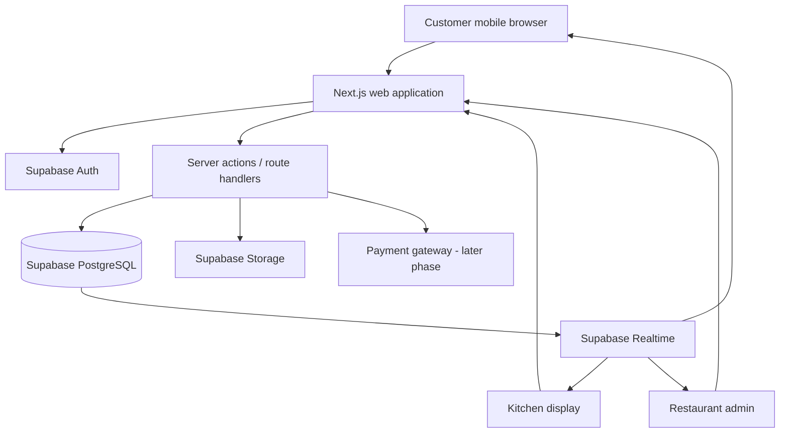
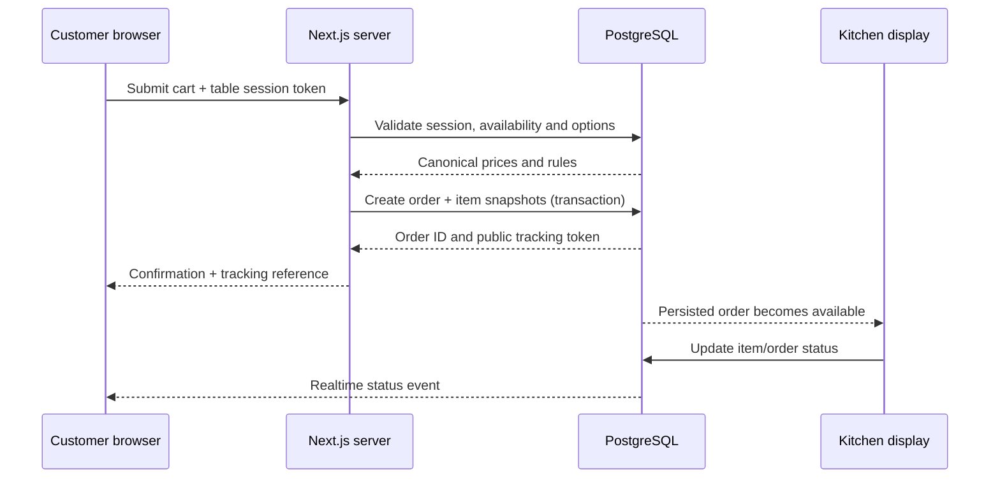

# 03 — System Architecture

## 1. Architecture principles
- Multi-tenant from day one.
- Secure by default: tenant isolation enforced by PostgreSQL RLS and server-side authorization.
- Database is the source of truth; realtime only distributes updates.
- Customer ordering is guest-first and mobile-first.
- Keep the MVP modular; avoid premature microservices.
- Preserve order snapshots for reliable billing and audit history.

## 2. High-level architecture

## 3. Logical domains
1. Tenant & identity: restaurants, profiles, memberships/permissions.
2. Restaurant configuration: settings, tables, QR tokens, sessions.
3. Catalog: categories, products, variants, option groups, add-ons, stations.
4. Ordering: orders, order items, item options, status history.
5. Payments: payment attempts, payment records, refunds.
6. Reporting: aggregated metrics and reporting queries.

## 4. Multi-tenant boundary
Every restaurant-owned resource must be tenant-scoped. A user's membership links an authenticated identity to a restaurant and a role such as `owner`, `admin` or `kitchen`. This is not a staff-management feature; it is the minimum authorization model required to protect the three interfaces.

For public customer access, use narrowly scoped public operations and table/order session tokens. Never grant broad anonymous SELECT access to private order tables. Prefer server-side functions that return only the fields needed for the active table/order.

## 5. Order submission sequence

## 6. Kitchen station routing
Products map to a configured preparation station, e.g. Pizza, Grill, Beverage or Dessert. Kitchen display groups order items by station while retaining the parent order and table. A product without a station maps to the restaurant's default station. Station routing is configurable; it does not create a waiter or staff-management module.

## 7. Suggested deployment topology
- One Next.js application serving customer, kitchen and admin routes.
- Supabase hosted PostgreSQL/Auth/Realtime/Storage.
- Vercel hosting for the web application.
- Optional payment provider integration in a later phase.
- Optional thermal printer integration after validating hardware and browser constraints.

## 8. Resilience
- If realtime disconnects, clients refetch and use a controlled polling fallback.
- If order submission times out, client retries with the same idempotency key.
- If payment provider callback is delayed, payment state remains pending until verified server-side.
- If a QR token is revoked, new sessions are blocked; already-open sessions follow configured closure policy.
