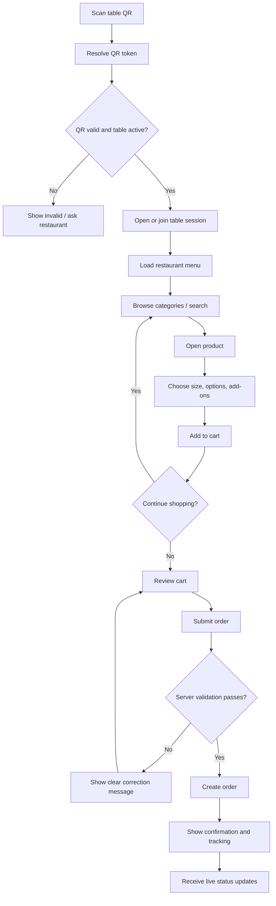
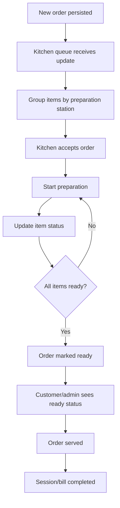
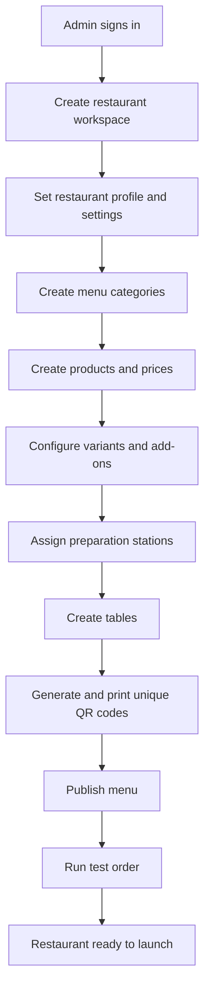
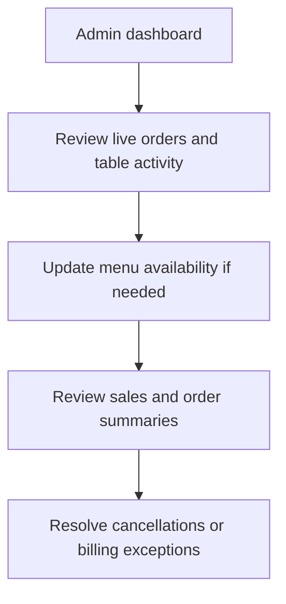

# 04 — User Flows

## 1. Customer QR ordering flow

## 2. Kitchen flow

## 3. Admin setup flow

## 4. Admin daily operations flow

## 5. Exceptional cases to handle
- Invalid, expired or revoked QR.
- Table inactive or session closed.
- Product becomes unavailable after being added to cart.
- Price changes while cart is open.
- Customer double-taps Place Order.
- Customer loses connectivity after submitting.
- Realtime event missed after reconnect.
- Kitchen rejects/cancels an item with a reason.
- Partial readiness when items are prepared by different stations.
- Payment pending, failed or duplicated callback.
