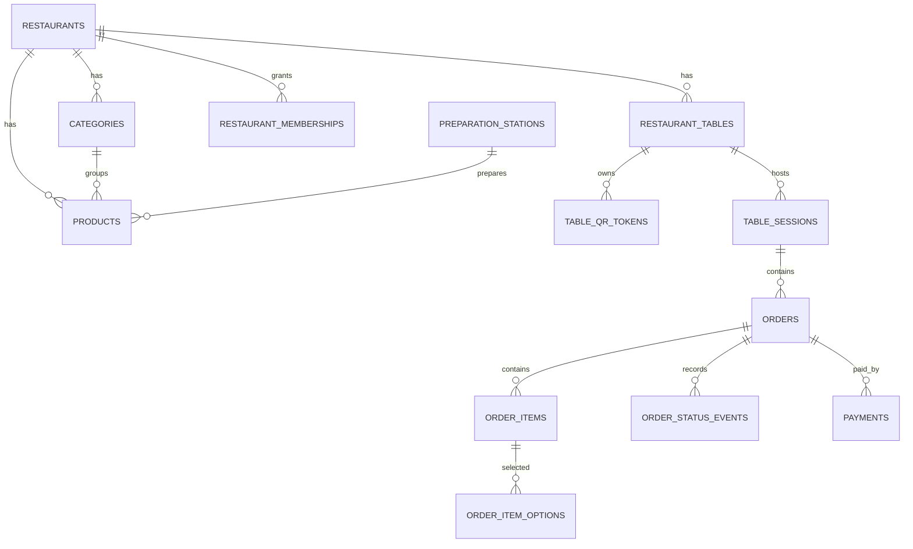

# 06 — Initial Database Design

This is a logical starting schema. Exact SQL types, indexes, constraints and RLS policies should be implemented in versioned Supabase migrations.

## 1. Core tables

| Table | Important fields | Purpose |
|---|---|---|
| restaurants | id, name, slug, logo_url, timezone, currency, settings, created_at | Tenant root |
| profiles | id (auth user), display_name | Auth identity profile |
| restaurant_memberships | id, restaurant_id, user_id, role, active | Minimum owner/admin/kitchen authorization |
| restaurant_tables | id, restaurant_id, table_number, label, active | Physical tables |
| table_qr_tokens | id, table_id, token_hash, active, created_at, revoked_at | Rotatable QR credentials |
| table_sessions | id, restaurant_id, table_id, status, opened_at, closed_at | Dining session |
| categories | id, restaurant_id, name, description, image_url, sort_order, active | Menu categories |
| products | id, restaurant_id, category_id, name, description, image_url, base_price, dietary_type, station_id, active, available | Menu products |
| option_groups | id, restaurant_id, name, required, min_select, max_select | Customization groups |
| option_values | id, option_group_id, name, price_delta, active | Options such as toppings |
| product_option_groups | product_id, option_group_id, sort_order | Product-option mapping |
| preparation_stations | id, restaurant_id, name, sort_order, active | Pizza, grill, beverage etc. |
| orders | id, restaurant_id, table_session_id, order_number, status, subtotal, discount, tax, service_charge, total, payment_status, idempotency_key, created_at | Order header |
| order_items | id, order_id, product_id, product_name_snapshot, quantity, unit_price_snapshot, notes, station_name_snapshot, status | Immutable purchase snapshot |
| order_item_options | id, order_item_id, option_name_snapshot, price_delta_snapshot | Selected options snapshot |
| order_status_events | id, order_id, from_status, to_status, actor_user_id, reason, created_at | Audit trail |
| payments | id, order_id, provider, provider_reference, amount, status, created_at | Payment records |

## 2. Relationship overview

## 3. Data integrity rules
- Use UUID primary keys.
- Add `restaurant_id` to tenant-owned records or enforce tenant linkage through a parent relationship.
- Add foreign keys and check constraints for non-negative prices and valid quantities.
- Unique constraint on `(restaurant_id, table_number)` where table numbers must be unique within a restaurant.
- Unique constraint on `(restaurant_id, order_number)`.
- Unique idempotency key per restaurant for order submission.
- Never calculate order totals from client-supplied prices.
- Snapshot product/option names and prices into order items at order time.
- Use `numeric`/decimal types for money, not floating point.
- Add indexes for `(restaurant_id, created_at)`, `(restaurant_id, status)`, table/session lookups and order-item joins.
- Soft-delete/archive products and tables when historical references must remain valid.

## 4. RLS policy design
- Anonymous users may read only published menu data through safe public views/functions.
- Anonymous users must not directly read all table sessions or orders.
- Customer order creation must pass through a secure server operation that validates a scoped table session token.
- Authenticated members may access only restaurants where they have an active membership and an allowed role.
- Kitchen role can read/update permitted kitchen order fields, not restaurant billing settings or user membership data.
- Admin/owner can manage restaurant configuration within their tenant.
- Test policies with at least two separate restaurants and multiple roles before launch.
